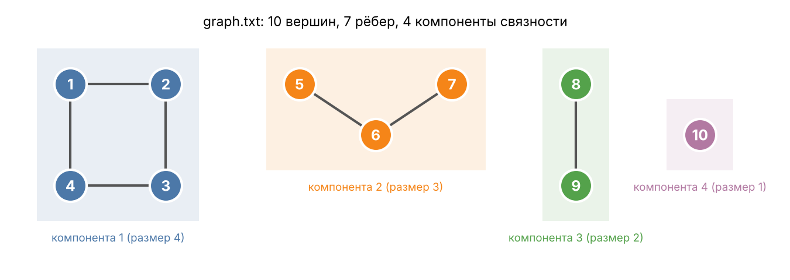

# Компоненты связности графа через рекурсивный DFS (рекурсия)

**Тема:** Алгоритмическая задача — Julia

## Описание задачи

Программа находит все компоненты связности неориентированного графа. Компонента
связности — это максимальная группа вершин, в которой из любой вершины можно дойти по
рёбрам до любой другой. Вершина без рёбер — тоже отдельная компонента.

Граф читается из текстового файла: в первой строке — число вершин, дальше по одному
ребру на строке в виде двух номеров вершин; строки, начинающиеся с `#`, считаются
комментариями. Граф хранится списком смежности (для каждой вершины — массив её
соседей).

Поиск компонент — рекурсивный обход в глубину (DFS, depth-first search). Функция
`dfs!` помечает вершину как посещённую, добавляет её в текущую компоненту и
рекурсивно вызывает себя для каждого ещё не посещённого соседа. Главный цикл
перебирает все вершины; каждая ещё не посещённая вершина запускает новый обход, и
все вершины, до которых он дотянулся, образуют новую компоненту.

Граф из примера `graph.txt` (цветом выделены компоненты, которые должна найти программа):



## Формат входных и выходных данных

Входные данные — путь к файлу графа аргументом командной строки (по умолчанию
`graph.txt` рядом с программой).
Выходные данные — число вершин и рёбер, число компонент, состав и размер каждой
компоненты, размер наибольшей.

## Запуск

Нужна Julia (установка: `curl -fsSL https://install.julialang.org | sh`).

```bash
julia components.jl              # граф из graph.txt
julia components.jl my_graph.txt
```
